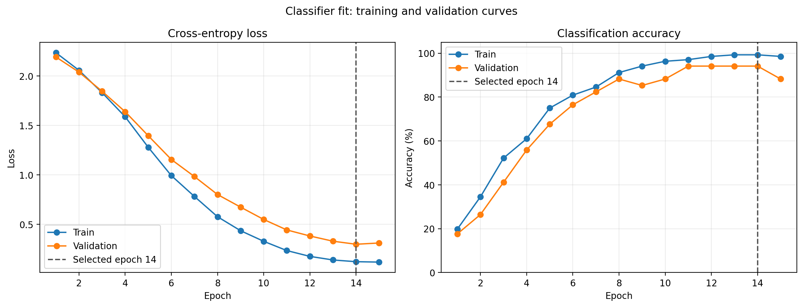
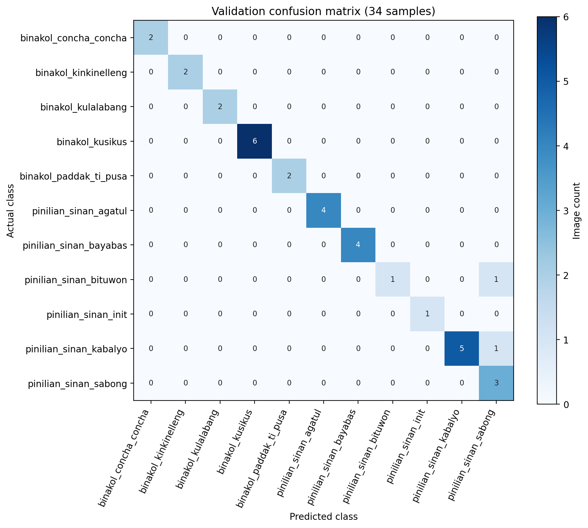

# PatternGuard Evaluation — Objectives 1–3

The full report, with detailed methodology, discussions, code excerpts, tables,
and figures, is [PatternGuard_Objectives_1_to_3_Results.docx](./PatternGuard_Objectives_1_to_3_Results.docx).

## Objective 1 — Hybrid DSP and rule-based geometry

The implementation applies image resizing and grayscale conversion, FFT
autocorrelation for repeat-spacing estimation, deterministic geometry votes
for wallpaper-symmetry labeling, rule-based defect isolation, and
template-aligned donor-patch restoration. The Word report includes the
relevant implementation excerpts and executed image output from resizing
through reconstruction. It distinguishes the synthetic demonstration from
real textile damage and treats group labels as heuristic.

## Objective 2 — System accuracy, SFS, and textile classification

The system evaluation used **all 170 source images**, resized to 256 × 256,
with six synthetic damage variants each (**1,020 cases total**). The original
clean image is the repair reference. The same 1,020 cases are used throughout
Objective 2; no source cases or damage variants are sampled out.

| System metric | Mean result |
|---|---:|
| SSIM | 98.32% |
| Restoration accuracy | 73.89% |
| Recall | 100.00% |
| FPR | 1.24% |
| IoU (mean per case) | 83.74% |
| Prior-formula SFS | 88.31% |
| Weighted SFS | 88.63% |

### Why the SFS is below the 95% project target

The measured weighted SFS is **88.63%**, **6.37 percentage points below**
the 95.00% project target. Restoration accuracy (73.89%) and mean per-case
IoU (83.74%) contribute 25.86 and 8.37 points, respectively. SSIM contributes
24.58 points, recall contributes 15.00, and specificity (98.76%) contributes
14.81. The target was not reached; the component results help explain the
composite without implying that the project-defined weights are calibrated.

The revised formula retains the original weights:

`SFS = 0.35 × Accuracy + 0.25 × SSIM + 0.15 × Recall + 0.15 × (100 − FPR) + 0.10 × IoU`

The current formula has no additional clean-region multiplier. Repair
Accuracy counts a damaged pixel as repaired only when its reconstructed
intensity is within 12 levels of the clean reference; the earlier
implementation incorrectly rewarded large differences. The **88.63%**
weighted SFS and **88.31%** prior-formula comparison use the same corrected
components across all 1,020 cases. The prior-formula value additionally
applies a penalty for changes outside the synthetic repair mask.

The 95.00% value is a project target, not an independently validated
acceptance threshold. It has not been achieved in this evaluation. Changing
weights, rounding, or excluding cases would not constitute improved measured
performance; the target requires better restoration accuracy and mask overlap
under the same six variants and all 170 source images.

The score remains a project-defined composite, not an independently validated
“symmetry fidelity” percentage: the formula has no direct comparison against
expert symmetry labels. It should be presented alongside its component metrics.

### Textile classification and fit

The deployed classifier's 94.12% accuracy is a **resubstitution** result on
the same 170 images used to train its checkpoint. It is not a held-out test
score. Its confusion matrix is provided as a diagnostic:
[application classifier confusion matrix](./figures/classification_confusion_matrix.png).

A separate experiment trained a fresh MobileNetV3-Small with a stratified
136/34 train/validation split (seed 42). This fresh model is not the deployed
checkpoint.

| Fit experiment, selected epoch 14 | Samples | Accuracy | Macro F1 |
|---|---:|---:|---:|
| Training split | 136 | 99.26% | 98.86% |
| Validation split | 34 | 94.12% | 93.87% |





Training and validation loss both declined through most epochs. Validation
loss reached its minimum at epoch 14 (0.298), then rose slightly at epoch 15;
validation accuracy fell from 94.12% to 88.24% while training accuracy ended
at 98.53%. This is a **mild late-overfit warning**, but the project's heuristic
still reports no clear overfit/underfit signal: the selected-checkpoint
train/validation gap is 5.15 points (below its 15-point threshold), and both
final accuracies exceed the 80% underfit threshold. Thus there is no evidence
of underfitting in this run, and overfitting is not conclusively established.
The validation set is small (34 images, with only 1–6 images per class) and
comes from the same collection; a larger independent test set is needed.

## Objective 3 — Restoration algorithms, time, and space

All three restorers received the same **1,020 paired cases**: 170 source
images × six fixed masks across 11 textile classes. MAE and PSNR are measured
on known damaged RGB pixels against the clean source. Time is median
restoration-stage time per case after one warm-up and five timed calls.

| Algorithm | Masked RGB MAE ↓ | Masked PSNR (dB) ↑ | Median restoration (ms) ↓ | Time complexity (analytical) | Auxiliary space (analytical) |
|---|---:|---:|---:|---|---|
| DSP template alignment | 19.87 | 18.00 | 3.21 | O(N + Σ A_roi·A_patch), conservative direct-correlation bound | O(N + max A_roi) |
| PatchMatch exemplar | 38.17 | 13.67 | 29.73 | O(T·(N + R·p²·C)); T ≤ damaged pixels, fixed patch width p | O(N·C + T) |
| OpenCV Navier–Stokes | 23.32 | 17.30 | 1.15 | Implementation-dependent; local-neighborhood model O(N + U·f(r)) | O(N·C + N) |

Here N=H×W, C is channel count, U is damaged-pixel count, T is the
PatchMatch fill-iteration count, R is bounded candidate checks per iteration,
p is fixed patch width, and A_roi/A_patch are DSP search and donor-patch
areas. OpenCV's internal Navier–Stokes complexity is implementation-dependent;
the table's local-neighborhood model is not an OpenCV guarantee. Space bounds
are analytical; peak memory was not measured.

DSP had the lowest aggregate masked error. Its paired source-image MAE
advantage was 18.30 versus PatchMatch (95% bootstrap interval 16.93–19.70) and
3.45 versus Navier–Stokes (2.19–4.65). Navier–Stokes was fastest at 1.15 ms
median; DSP took 3.21 ms and PatchMatch 29.73 ms. For this synthetic dataset,
DSP offered the best measured reconstruction quality while Navier–Stokes
offered the lowest latency. Bootstrap intervals resample source images, not
individual masks, and are descriptive for this dataset only.

In the full system evaluation, defect detection averaged 0.28 ms and
restoration averaged 36.01 ms per 256 × 256 case. These are component timings,
not end-to-end request latency; image loading, repeat-spacing estimation, and
web request overhead are not included in those two means.

## Evaluation limits and reproduction

All damage cases are synthetic; no natural-damage benchmark or
expert-annotated symmetry ground truth is included. The application classifier
measurements are in-sample, and wallpaper-group agreement is only 2.94% against
unverified metadata. These limitations prevent claims of independently
validated classification generalization or symmetry fidelity.

For a live panel run that prints the method and result tables without the
three-algorithm benchmark or a Word export, run from the repository root:

```powershell
.\.venv\Scripts\python.exe run_panel_evaluation.py
```

It reruns the unit suite and all 1,020 system damage cases, then saves the
case-level CSV and JSON summary under `evaluation_report\panel_evaluation\`.
The 34-image classifier validation set is a separate experiment, not the
sample size for the synthetic system metrics.

To run the full workflow and refresh the Word report, use:

```powershell
python -m venv .venv
.\.venv\Scripts\python.exe -m pip install -r requirements.txt
.\.venv\Scripts\python.exe run_project_evaluation.py
```

Use this same virtual-environment interpreter for the tests and evaluation;
do not mix it with a separate system Python installation.

The runner executes the unit suite, 1,020-case system evaluation, 1,020-case
three-algorithm benchmark, and DSP figure generation, then refreshes the Word
report. It embeds the existing classifier-fit history; run
`python evaluate_classifier_fit.py` first if those fit artifacts should be
refreshed. Detailed outputs are in
[system_evaluation/](./system_evaluation/),
[restoration_benchmark_results.csv](./restoration_benchmark_results.csv),
[restoration_benchmark_summary.json](./restoration_benchmark_summary.json),
and [figures/](./figures/).

Figures: [system SFS components](./figures/system_accuracy_metrics.png),
[algorithm comparison](./figures/algorithm_comparison.png),
[system stage timing](./figures/system_stage_timing.png),
[DSP pipeline stages](./figures/dsp_pipeline_stages.png),
[application classifier confusion matrix](./figures/classification_confusion_matrix.png),
[classifier fit curves](./figures/classification_fit_curves.png), and
[validation confusion matrix](./figures/classification_validation_confusion_matrix.png).
